> More Projects at https://zsync.eu
> Tool was previously unreleased 


<div align="center">

# ZDECK

**A GitHub management & activity dashboard for the terminal.**

Every repository you own — issues, pull requests, stars, activity and code volume — in one place.

[](LICENSE)
[](https://www.python.org/)
[](https://textual.textualize.io/)

[Source](https://github.com/TheHolyOneZ/ZGitHubDeckPy) ·
[Author](https://github.com/TheHolyOneZ) ·
[More projects](https://zsync.eu/)

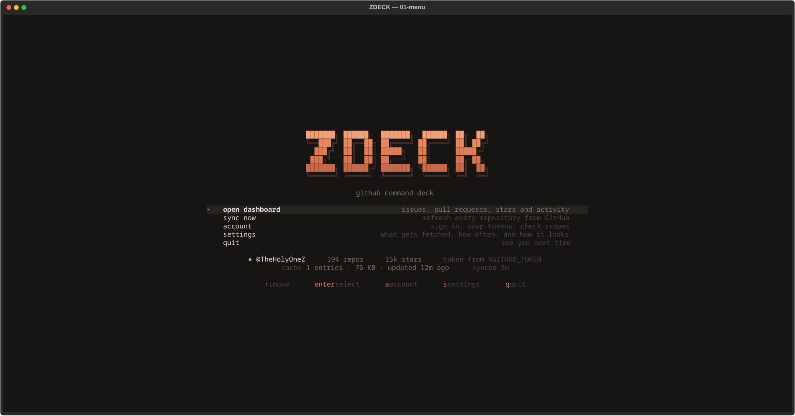

</div>

---

## Contents

- [Why](#why)
- [Install](#install)
- [Signing in](#signing-in)
- [The five views](#the-five-views)
- [Filtering](#filtering)
- [Exporting](#exporting)
- [Keys](#keys)
- [Settings](#settings)
- [How it stays fast](#how-it-stays-fast)
- [Token permissions, in practice](#token-permissions-in-practice)
- [Project layout](#project-layout)
- [Links](#links)
- [License](#license)

---

## Why

If you own 190 repositories, opening 190 issue tabs is not a workflow.

ZDECK collapses everything you own or help maintain into **five aggregate views**, each
with its own filter box, each exportable to a file you can share.

| View | What it gives you |
|---|---|
| **Issues** | Every open issue across every repository, with repo, author, age and colour-coded labels |
| **Pull requests** | Review load, CI verdict and mergeability, sorted so what's broken floats to the top |
| **Stars** | Who starred what, and when — newest first, grouped by day |
| **Activity** | Unread notifications, then pushes, forks, releases and reviews |
| **Code** | Every line you have ever committed, per repository and in total |

It starts instantly (the last sync is on disk), it respects GitHub's rate limits, and it
keeps working when the network doesn't.

## Install

```bash
git clone https://github.com/TheHolyOneZ/ZGitHubDeckPy.git
cd ZGitHubDeckPy
python3 -m venv .venv
.venv/bin/pip install -r requirements.txt
.venv/bin/python -m github_dashboard
```

Dependencies are just three:

```bash
pip install textual rich httpx
```

> **Arch, Debian 12+, Fedora and other PEP 668 distros** block installing into the system
> Python, so the virtual environment above isn't optional. If you'd rather install
> globally, use `pipx` or `pip install --user --break-system-packages`.

Requires **Python 3.10+** — the code uses `X | Y` type syntax at runtime.

## Signing in

**Just start the app.** With no token it opens the sign-in screen, which lists what each
permission unlocks and can open GitHub's token page for you with the right boxes already
ticked (`ctrl+o`). Paste, press enter — it validates, saves to `~/.config/zdeck/token`
with `0600` permissions, and drops you into the dashboard.

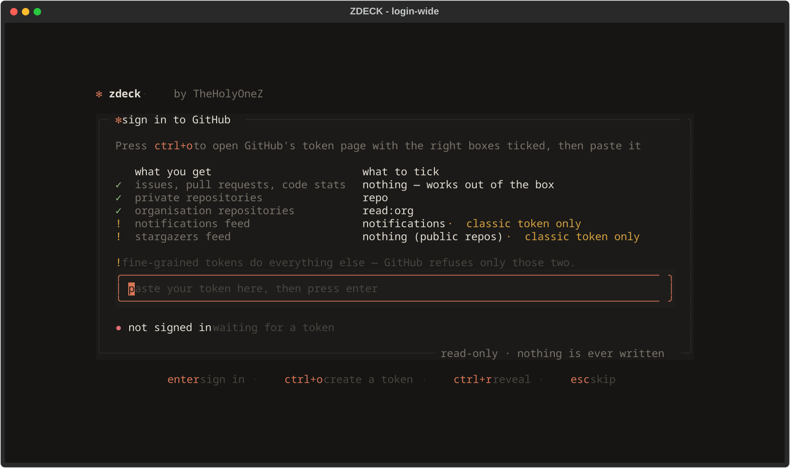

Prefer to do it yourself? Any of these work:

```bash
export GITHUB_TOKEN=ghp_your_token_here     # never touches disk
gh auth login                               # ZDECK picks up `gh auth token`
```

ZDECK looks in that order: `$GITHUB_TOKEN` → `$GH_TOKEN` → `~/.config/zdeck/token` →
`gh auth token`. The sign-in screen shows which one won.

**ZDECK only ever issues GET requests.** It cannot modify anything in your account.

## The five views

### Issues

Repository, number, title, author, labels, age and comment count — sortable by any of
them, filterable down to a handful in three keystrokes.

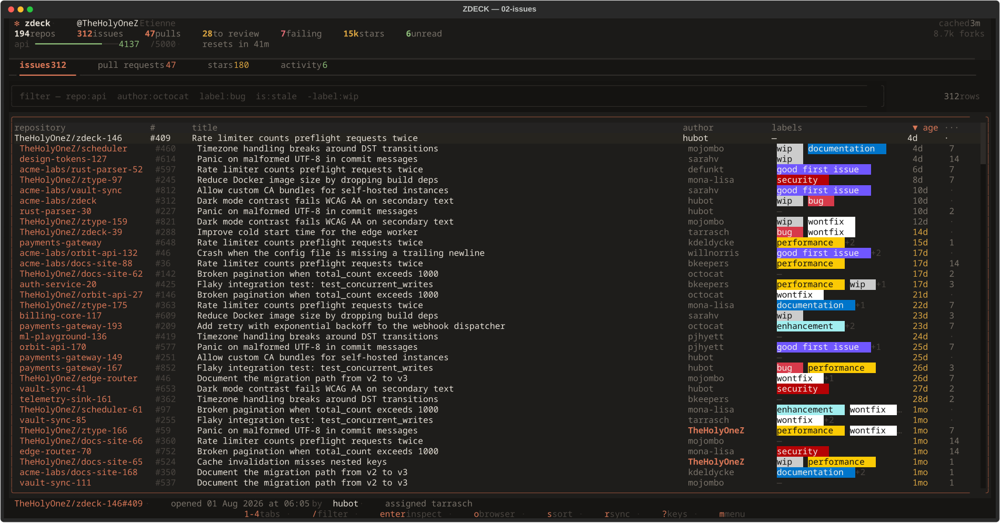

### Pull requests

The default sort puts conflicts and red CI at the top. The status line shows the branch,
diff size and who the review is waiting on.

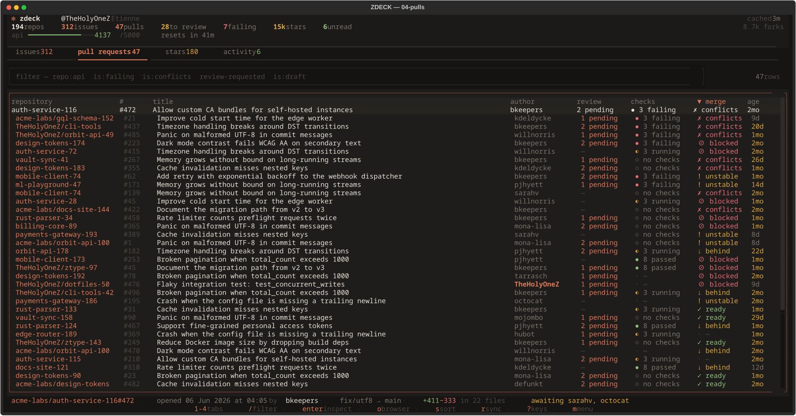

### Stars

Grouped by day, newest first, across every repository you own.

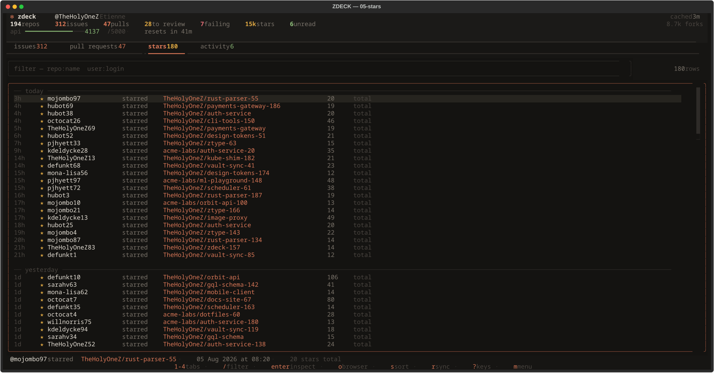

### Activity

Unread notifications first, then the event stream.

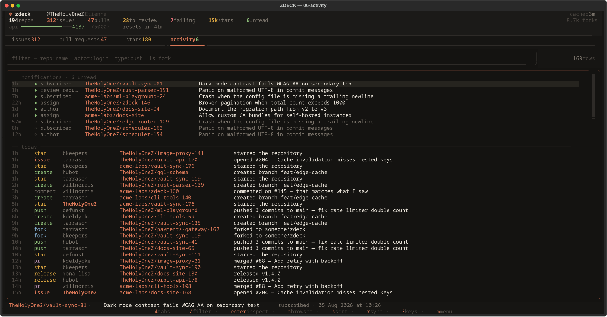

### Code

Press `c` to scan every repository. Lifetime additions and deletions per repo are
**exact** — they come from GitHub's contributor statistics. Current size by language is
estimated from byte counts, and the UI says so.

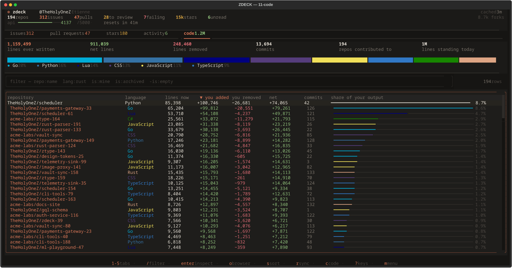

### Inspecting a row

Press `enter` on any issue or pull request to read the whole conversation, rendered
markdown and all, without leaving the terminal.

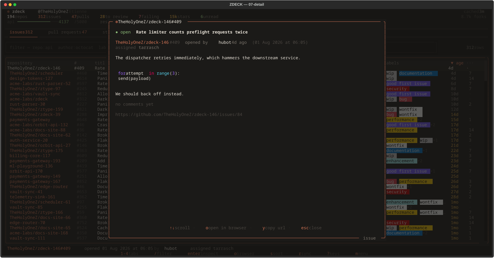

## Filtering

Every tab has its own filter box (`/`). The grammar is deliberately small:

| Query | Meaning |
|---|---|
| `payment retry` | bare words match the title and repository |
| `repo:api` | repository name contains `api` |
| `owner:acme` | everything under one account |
| `author:octocat` | opened by that person |
| `label:bug` | carries that label |
| `assignee:octocat` | assigned to that login |
| `reviewer:octocat` | pull requests waiting on that reviewer |
| `is:stale` | untouched for more than 30 days |
| `is:unassigned` `is:unanswered` | issues nobody has picked up or replied to |
| `is:failing` `is:conflicts` `is:draft` | pull request states |
| `lang:rust` `is:mine` | code tab: by language, or repos you committed to |
| `-label:wip` | negate any qualifier with a leading dash |

Qualifiers combine with AND. Matching is substring-based and case-insensitive.

## Exporting

Press `e` on any tab. The default is *what you are looking at right now* — the filter
you typed is carried into the export and recorded in the file, so `label:bug is:stale`
becomes a bug backlog you can hand to somebody.

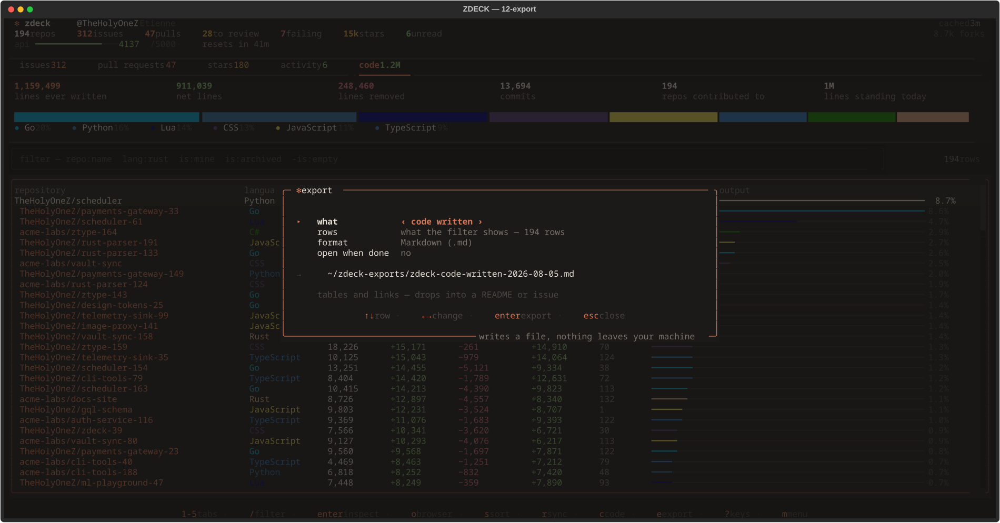

| Format | Good for |
|---|---|
| **Markdown** `.md` | pasting into a README, an issue, or a status update |
| **HTML** `.html` | sharing — one self-contained file, searchable and sortable, GitHub Pages ready |
| **CSV** `.csv` | spreadsheets |
| **JSON** `.json` | scripting against the data |

Files land in `~/zdeck-exports/` as `zdeck-<what>-<date>.<ext>`, and an existing file is
never silently overwritten.

The HTML export follows the reader's light or dark theme, keeps GitHub's real label
colours, and carries a search box and sortable columns — with no external assets, so it
works from `file://`, from a Pages site, or as an email attachment.

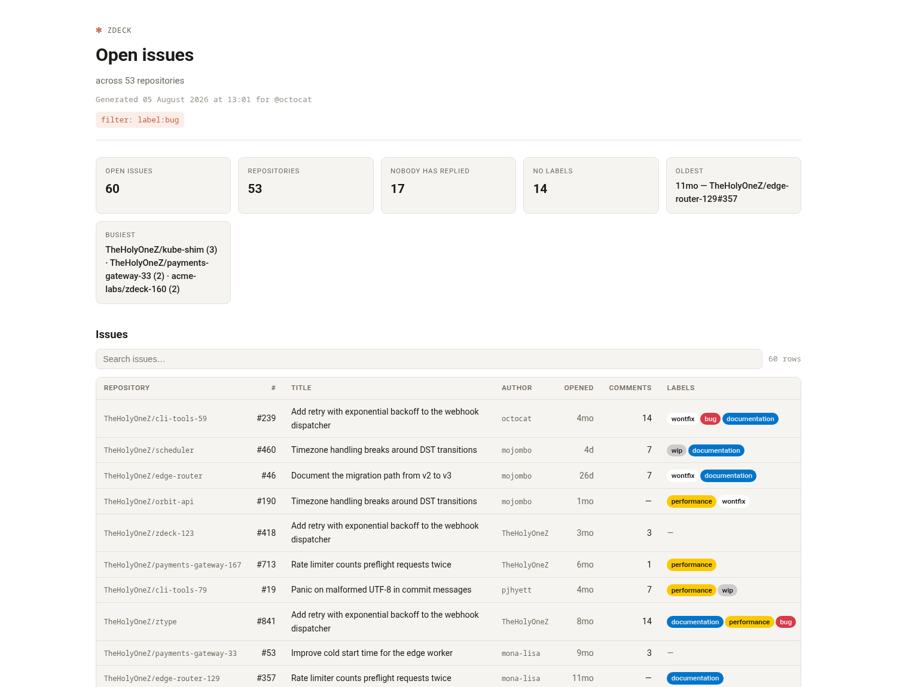

## Keys

| Screen | Key | Action |
|---|---|---|
| **Sign in** | `enter` | Validate and save the token |
| | `ctrl+o` | Open GitHub's token page with scopes pre-ticked |
| | `ctrl+r` | Reveal what you typed |
| | `ctrl+d` | Sign out and delete the stored token |
| **Menu** | `↑` `↓` | Move selection |
| | `enter` | Select |
| | `a` / `s` | Account / settings |
| | `q` | Quit |
| **Dashboard** | `1` … `6` | Issues / pull requests / stars / activity / code / about |
| | `[` `]` | Previous / next tab |
| | `↑` `↓` `pgup` `pgdn` | Move the row cursor |
| | `enter` | Inspect the issue or pull request |
| | `o` | Open the selected row on github.com |
| | `y` | Copy the selected row's URL |
| | `s` / `S` | Cycle sort order / reverse it |
| | `/` | Focus the filter box |
| | `esc` | Clear the filter, then leave the box, then go back |
| | `r` | Sync with GitHub |
| | `R` | Clear the cache and do a full sync |
| | `c` | Measure code volume across every repository |
| | `e` | Export this view to Markdown / HTML / CSV / JSON |
| | `?` | Key and filter reference |
| | `m` | Back to the menu |
| **Settings** | `↑` `↓` | Change row |
| | `←` `→` | Change value |
| | `c` | Clear the local cache |
| | `esc` | Back |

Clicking a column header sorts by it. The mouse works throughout.

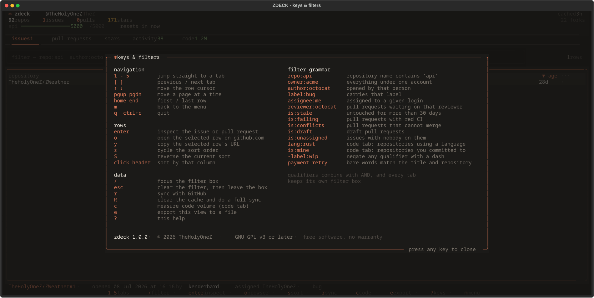

## Settings

Press `s` from the menu. Everything saves as you go to `~/.config/zdeck/settings.json`.

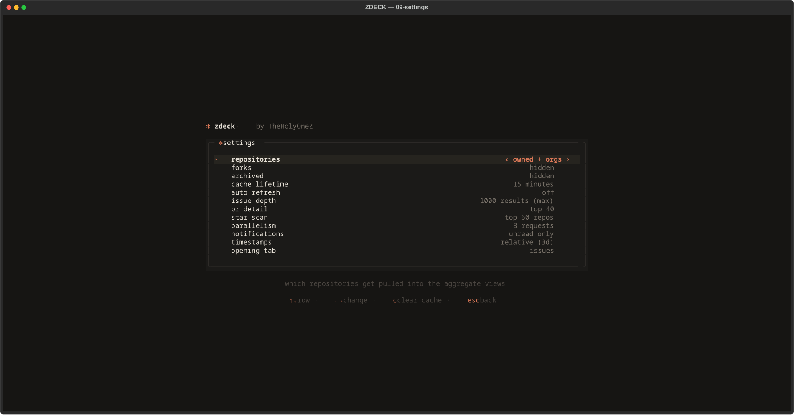

| Option | Notes |
|---|---|
| `repositories` | owned only / owned + orgs / owned + orgs + collaborations |
| `forks` · `archived` | whether those repositories count |
| `cache lifetime` | how long a cached response stays fresh (default 15 min) |
| `auto refresh` | background resync while the dashboard is open |
| `issue depth` | 200 / 500 / 1000 results — GitHub's search API caps at 1000 |
| `pr detail` | how many PRs get mergeability + CI resolved (costs 3 requests each) |
| `star scan` | how many repositories to scan for recent stargazers |
| `parallelism` | simultaneous in-flight requests |
| `notifications` | unread only, or everything recent |
| `timestamps` | relative (`3d`) or absolute dates |
| `opening tab` | which tab the dashboard lands on |

**If you have a lot of archived repositories, turn `archived` on.** They are hidden by
default, and archived work still counts toward your lifetime line count.

## How it stays fast

**190 repositories is 190 requests if you do it naively.** ZDECK doesn't.

- **Search instead of fan-out.** Asking each repository for its issues costs one request
  per repository. One `search/issues` query per *account* (`user:you`, `org:acme`)
  returns the same data in a handful of requests, so a full sync costs tens of requests
  rather than hundreds.
- **Stargazers in one request each.** GitHub returns stargazers oldest-first, so the
  newest ones live on the last page. ZDECK computes that page number from the star count
  it already has and jumps straight to it.
- **Conditional requests.** Every GET carries `If-None-Match` when an ETag is cached.
  GitHub answers `304 Not Modified` and **does not** decrement your hourly quota.
- **Two rate limits, respected separately.** The core bucket is 5000/hour; search is a
  much tighter 30/minute and is enforced independently, so search calls go through their
  own paced throttle.
- **The rate gauge trusts response headers**, not `/rate_limit` — that endpoint is served
  from a cache and can report a healthier budget than reality.
- **Staged, progressive sync.** Repos land, then issues, then pull requests, then stars,
  then activity — each stage paints as it arrives. A failed stage is reported and
  skipped; a rate-limited star scan never costs you the issue list.
- **Stale beats broken.** If the network is unreachable, the client serves the last
  cached body rather than raising. The header says `cached` instead of `synced`.

Measured against a real 191-repository account:

| | Cold | Warm |
|---|---|---|
| Full sync | 9.6 s · 71 requests | 2.6 s |
| Code scan | 85.6 s · 562 requests | 0.7 s |

Cache lives in `~/.cache/zdeck/cache.sqlite3`. Delete it, or press `R` in the dashboard,
to start clean.

## Token permissions, in practice

Measured against the live API, not guessed:

| Feature | Classic PAT | Fine-grained PAT |
|---|---|---|
| Repos, issues, pull requests | ✅ `repo` for private | ✅ Metadata + Issues + Pull requests, read |
| Code volume | ✅ | ✅ Metadata: read |
| **Stargazers** | ✅ no scope needed for public | ❌ GitHub demands `Contents: write` |
| **Notifications** | ✅ `notifications` scope | ❌ not available at all |

Both unsupported cases fail soft: the tab stays empty and the app tells you why rather
than pretending there is no data. If you want the stars feed and notifications, use a
classic token.

> **On multiple tokens:** GitHub's rate limit is per *account*, not per token — several
> PATs on one account share one 5,000/hour bucket. Adding more tokens gains you nothing.

## Project layout

```
github_dashboard/
├── main.py                   entry point, app shell, sync worker, screen routing
├── config/
│   └── settings.py           paths, endpoints, token resolution, preferences
├── api/
│   ├── github_client.py      async httpx client: ETags, retries, rate limits
│   ├── cache_manager.py      SQLite response cache
│   └── store.py              aggregate state + staged sync orchestration
├── models/
│   └── data_types.py         dataclasses for repos, issues, PRs, stars, events, code
├── export/
│   ├── report.py             format-agnostic description of an export
│   ├── markdown.py           → GitHub-flavoured Markdown
│   ├── html.py               → one self-contained, themed HTML page
│   └── writer.py             CSV, JSON, filenames, writing to disk
├── ui/
│   ├── theme.py              palette + the single Textual stylesheet
│   ├── screens/              menu, sign-in, settings, dashboard, detail, export, help
│   └── widgets/              header bar, tables, feeds, code summary, about, filters
└── utils/
    ├── formatters.py         ages, truncation, label chips, badges, gauges
    └── filters.py            the filter grammar
```

## Links

| | |
|---|---|
| **Project** | [github.com/TheHolyOneZ/ZGitHubDeckPy](https://github.com/TheHolyOneZ/ZGitHubDeckPy) — source, issues and releases |
| **Author** | [github.com/TheHolyOneZ](https://github.com/TheHolyOneZ) — everything else I have built |
| **More projects** | [zsync.eu](https://zsync.eu/) — the rest of my work |

The same three links live in the app itself, on the **about** tab (`6`) — `↑↓` to
choose one, `enter` opens it in your browser, `y` copies it.

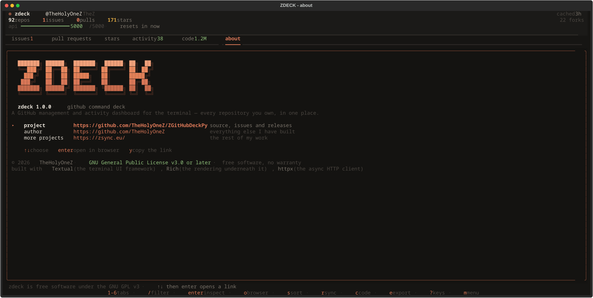

## Credits

Built with [Textual](https://textual.textualize.io/) and [Rich](https://rich.readthedocs.io/)
by [Textualize](https://www.textualize.io/), and [httpx](https://www.python-httpx.org/).

## License

**[GNU General Public License v3.0 or later](LICENSE)** © 2026 TheHolyOneZ

ZDECK is free software: you can redistribute it and/or modify it under the terms of the
GNU GPL as published by the Free Software Foundation, either version 3 of the License,
or (at your option) any later version.

It is distributed in the hope that it will be useful, but **without any warranty** —
without even the implied warranty of merchantability or fitness for a particular
purpose. See the [LICENSE](LICENSE) file for the full text.

In short: you are free to use, study, share and modify it. If you distribute a modified
version, or ship it as part of something else, that work has to be released under the
GPL too, with source available.

Textual, Rich and httpx are MIT/BSD licensed, which is compatible with the GPL.
